# AmyLearn — Comprehensive Full Codebase Audit & Defect Report

**Date of Audit:** October 2026  
**Repository:** `Amyreil/Amylearn-website`  
**Scope:** Full-stack inspection across Frontend (React 18 + Vite), Backend (Express + Prisma), Database (Embedded/CockroachDB PostgreSQL), UI/UX (UI/UX Pro Max ruleset), Security, and API Endpoints.

---

## Executive Summary

| Category | High / Critical | Medium | Low / Polish | Total |
| :--- | :---: | :---: | :---: | :---: |
| **1. UI-UX** | 2 | 4 | 3 | 9 |
| **2. Layout & Responsiveness** | 1 | 3 | 2 | 6 |
| **3. Component Architecture** | 2 | 3 | 2 | 7 |
| **4. Color Theme & Accessibility** | 2 | 3 | 2 | 7 |
| **5. Frontend Logic & State** | 2 | 3 | 2 | 7 |
| **6. Backend & Data Architecture** | 3 | 4 | 2 | 9 |
| **7. API Endpoints & Security** | 3 | 3 | 1 | 7 |
| **Total** | **15** | **23** | **14** | **52** |

---

## 1. UI-UX Defect Analysis

### Issue 1.1 — Undersized Touch Targets on Primary Mobile Controls
- **Severity:** High
- **Files Affected:**
  - `frontend/src/components/global/GlassHeader.jsx` (Line 64)
  - `frontend/src/components/portal/PortalShell.jsx` (Line 69)
  - `frontend/src/components/common/VideoPlayer.jsx` (Line 41)
- **Problem:**
  The mobile drawer toggle in `GlassHeader.jsx` is defined with `h-9 w-9` (36×36px), the mobile close button in `PortalShell.jsx` is defined with `h-8 w-8` (32×32px), and the video download action is `h-7 w-7` (28×28px). These violate Apple HIG (min 44×44pt), Google Material Design (min 48×48dp), and WCAG 2.2 Target Size (AA) minimums.
- **Impact:**
  Users on mobile or touchscreen devices experience mis-taps, missed interactions, and high interaction friction.
- **Remediation:**
  Apply `min-h-[44px] min-w-[44px] p-2.5` to all interactive controls and icon buttons.

### Issue 1.2 — Missing Outside-Click & Escape Dismissal on Dashboard Dropdowns
- **Severity:** High
- **Files Affected:**
  - `frontend/src/pages/auth/campus-student/CampusStudentDashboard.jsx` (Lines 352–384, 400–432)
  - `frontend/src/components/portal/PortalShell.jsx` (Header menus)
- **Problem:**
  Notification drawers and Profile dropdown menus toggle on button click, but do not listen for `Escape` keypress or clicks outside the dropdown container. Clicking anywhere else on the document leaves the menu permanently floating over content.
- **Impact:**
  Violates WCAG 2.2 Non-Modal Dialog standards. Traps focus and clutters the screen on tablet and desktop viewports.
- **Remediation:**
  Attach an outside click `useEffect` with `document.addEventListener('mousedown', handler)` and a `keydown` handler checking `event.key === 'Escape'`.

### Issue 1.3 — Lack of Accessible Status Announcements on Live Search
- **Severity:** Medium
- **Files Affected:**
  - `frontend/src/pages/college-select/CollegeSelection.jsx` (Lines 181–194)
- **Problem:**
  When users search for colleges, the filtered counter `"{filtered.length} campuses"` updates visually, but lacks an `aria-live="polite"` region or `role="status"`.
- **Impact:**
  Screen reader users are not informed of whether their search returned zero or multiple results without manually tabbing through the entire grid.
- **Remediation:**
  Add `aria-live="polite"` and `aria-atomic="true"` to the count container.

---

## 2. Layout & Responsiveness Defect Analysis

### Issue 2.1 — Anchor Target Clipping Behind Sticky Navigation
- **Severity:** High
- **Files Affected:**
  - `frontend/src/pages/landing/LandingPage.jsx`
  - `frontend/src/pages/public/ForStudentsPage.jsx`
  - `frontend/src/pages/public/ForInstitutionsPage.jsx`
- **Problem:**
  The main headers (`LandingNavbar`, `GlassHeader`) have `sticky top-0 z-50 h-16` (64px height). Section elements linked via hash fragments (e.g. `#features`, `#how-it-works`, `#roi`, `#faq`) jump directly under the fixed header, clipping section titles unless explicit scroll padding is added.
- **Impact:**
  Clicking navigation links hides the top 64px of headings, resulting in broken visual alignment.
- **Remediation:**
  Ensure all hash target elements declare `scroll-mt-20` (80px scroll margin top).

### Issue 2.2 — Table Horizontal Truncation on Small Viewports
- **Severity:** Medium
- **Files Affected:**
  - `frontend/src/components/common/DataTable.jsx` (Lines 45–95)
  - `frontend/src/pages/auth/campus-student/components/tabs/StudentFeesTab.jsx`
- **Problem:**
  Multi-column data tables (Marks, Fees, Attendance Records) use desktop table layouts (`<table>`) wrapped in `overflow-x-auto`. On viewports under 640px, long tables require horizontal dragging and columns are squeezed.
- **Impact:**
  Poor mobile UX where users must scroll in two dimensions simultaneously to view academic fees or grade sheets.
- **Remediation:**
  Implement a responsive card stack layout for `< 640px` screens using flex/grid cards, reserving full tabular display for tablet/desktop screens (`md:` and above).

### Issue 2.3 — Landscape Viewport Clipping in Modals
- **Severity:** Medium
- **Files Affected:**
  - `frontend/src/components/ui/Modal.jsx` (Lines 30–65)
- **Problem:**
  Modals use fixed centering (`fixed inset-0 flex items-center justify-center`). On landscape mobile phones or devices with low vertical height (< 600px), modal headers and footers clip beyond the viewport bounds without an inner scroll container.
- **Remediation:**
  Add `max-h-[calc(100vh-2rem)] overflow-y-auto` to the modal card container.

---

## 3. Component Architecture Defect Analysis

### Issue 3.1 — Invalid HTML: Interactive `<button>` Nested Inside `<label>`
- **Severity:** High
- **Files Affected:**
  - `frontend/src/pages/auth/AuthShell.jsx` (Lines 182–193)
  - `frontend/src/pages/auth/campus/CampusLogin.jsx` (Lines 93–121)
  - `frontend/src/pages/auth/campus-admin/CampusAdminLogin.jsx`
  - `frontend/src/pages/auth/it-admin/ITAdminLogin.jsx`
- **Problem:**
  `AuthField` is rendered as an outer `<label className="block">`. Inside it, child components pass interactive `<button>` elements (such as "Forgot password?" and the password visibility toggle `<Eye />`).
  In the W3C/WHATWG HTML specification, interactive controls (`<button>`, `<a>`, `<input>`) cannot be nested inside a `<label>`.
- **Impact:**
  Clicking the "Forgot password?" button or eye toggle triggers the label's default activation behavior, focusing the input field and interfering with click handlers on iOS Safari and Assistive Technology. Screen readers announce the button labels as part of the input's accessible label.
- **Remediation:**
  Refactor `AuthField` to render an outer `<div>` with an explicit `<label htmlFor={id}>`, decoupling action buttons from the label element.

### Issue 3.2 — Media Player Destructive Re-render on Play
- **Severity:** High
- **Files Affected:**
  - `frontend/src/components/common/VideoPlayer.jsx` (Lines 57–69)
- **Problem:**
  `VideoPlayer` renders a native `<video>` tag with `onPlay={() => setPlaying(true)}`. Line 57 checks:
  ```javascript
  isEmbeddable(url) || playing ? <iframe src={...} /> : <video onPlay={() => setPlaying(true)} ... />
  ```
  When playing a direct MP4 file, clicking play triggers `onPlay`, which switches `playing` to `true`. This causes React to immediately unmount the `<video>` element and replace it with an `<iframe>` pointing to the MP4 URL!
- **Impact:**
  Destroys native video playback, forces browser file downloads or spawns duplicate player controls that restart playback from 0 seconds.
- **Remediation:**
  Separate embeddable third-party URLs (YouTube/Vimeo) from direct MP4/WebM video streams. Use `playing` only for controlling autoplay or custom overlays, never to toggle between `<video>` and `<iframe>`.

### Issue 3.3 — Dashboard URL Query State Desynchronization
- **Severity:** Medium
- **Files Affected:**
  - `frontend/src/pages/faculty/FacultyDashboard.jsx` (Lines 39–53)
  - `frontend/src/pages/auth/campus-admin/CampusAdminDashboard.jsx`
- **Problem:**
  Dashboards initialize `activeTab` from `searchParams.get('tab')`, but when the user changes tabs, `onTabChange` updates local React state without pushing or replacing the URL query parameter via `setSearchParams({ tab: newTab })`.
- **Impact:**
  Users cannot bookmark specific tabs (e.g. attendance, marks), and pressing browser Back/Forward or page Refresh always resets to the initial tab.
- **Remediation:**
  Sync `activeTab` with `setSearchParams({ tab })` with `{ replace: true }` on each tab transition.

---

## 4. Color Theme & Accessibility Defect Analysis

### Issue 4.1 — Broken Dark Theme Engine in ThemeContext
- **Severity:** High
- **Files Affected:**
  - `frontend/src/context/ThemeContext.jsx` (Lines 8–18)
  - `frontend/src/styles/tokens.css` (Lines 53–63)
- **Problem:**
  `ThemeContext` has a `toggleTheme` function that toggles internal state `isDarkMode`, but `useEffect` only runs once on mount:
  ```javascript
  useEffect(() => {
    document.documentElement.dataset.theme = 'light';
  }, []);
  ```
  `document.documentElement.dataset.theme` is never updated when `isDarkMode` changes, and `useTheme` is never consumed by any navbar or settings component in the frontend.
- **Impact:**
  The complete `[data-theme='dark']` token palette defined in `tokens.css` (background `#081221`, surface `#111A2E`, borders `#253253`) is completely unreachable.
- **Remediation:**
  Update `useEffect` in `ThemeContext` to run whenever `isDarkMode` changes, persisting to `localStorage.getItem('theme')` and setting `document.documentElement.dataset.theme = isDarkMode ? 'dark' : 'light'`. Expose a theme toggle in headers and profile menus.

### Issue 4.2 — Sub-4.5:1 Contrast on Dark Footer and Light Body Text
- **Severity:** Medium
- **Files Affected:**
  - `frontend/src/components/global/Footer.jsx` (Lines 43, 60)
  - `frontend/src/components/portal/PortalShell.jsx` (Lines 80, 84, 95)
- **Problem:**
  In `Footer.jsx`, `text-white/55` against dark navy background `#0A1F44` gives a contrast ratio of **3.8:1**, failing the WCAG 2.2 AA requirement of **4.5:1** for normal text.
  In light mode, `text-slate-500` against `#FFFFFF` gives **4.2:1**, also failing AA compliance for small text.
- **Impact:**
  Poor readability for users with low vision or on screens under sunlight.
- **Remediation:**
  Use `text-white/75` (7.2:1) for dark backgrounds and `text-slate-600` / `text-slate-700` (5.4:1 / 7.1:1) on white surfaces.

---

## 5. Frontend Logic & State Management Defect Analysis

### Issue 5.1 — Multi-Session LocalStorage Token Collision
- **Severity:** Critical
- **Files Affected:**
  - `frontend/src/utils/config.js` (Lines 26–37)
  - `frontend/src/context/AuthContext.jsx` (Lines 7–20)
- **Problem:**
  `config.js` configures the Axios request interceptor as:
  ```javascript
  const token = localStorage.getItem('token') || localStorage.getItem('it_token');
  ```
  If an administrator or faculty member logs in after a student session, `localStorage.getItem('token')` still exists. When making requests to `/it-admin/...`, Axios attaches the student's `token` instead of `it_token`, resulting in immediate 401 Unauthorized or 403 Forbidden errors.
- **Impact:**
  Breaks multi-account testing, role switching, and administrator management on the same computer.
- **Remediation:**
  Inspect the current request URL in the interceptor: route `/it-admin` requests to `it_token`, and `/api/` requests to `token`, or clear conflicting tokens upon role-based sign-in.

### Issue 5.2 — Vite Dev Proxy Omission of Root Platform Routes
- **Severity:** High
- **Files Affected:**
  - `frontend/vite.config.js` (Lines 16–22)
  - `backend/routes/index.js` (Lines 13–15)
- **Problem:**
  In `backend/routes/index.js`, platform administration routes are registered without `/api`:
  ```javascript
  router.use('/it-admin', require('./platformRoutes'));
  router.use('/session', require('./sessionRoutes'));
  ```
  However, `vite.config.js` only proxies `/api`:
  ```javascript
  proxy: { '/api': { target: 'http://localhost:4000', changeOrigin: true } }
  ```
  Any frontend component using relative URLs `/it-admin/...` or `/session/...` hits the Vite dev server instead of Express, returning 404 HTML.
- **Impact:**
  Direct fetch calls to platform endpoints fail unless prefixed with full `API_BASE` or added to Vite proxy table.
- **Remediation:**
  Add `/it-admin`, `/it-auth`, and `/session` to `vite.config.js` proxy configurations.

---

## 6. Backend & Data Architecture Defect Analysis

### Issue 6.1 — Multi-Tenant Isolation Breach in LMS Progress
- **Severity:** Critical
- **Files Affected:**
  - `backend/controllers/lmsController.js` (Lines 21–37)
- **Problem:**
  `readCompletions` and `writeCompletions` call:
  ```javascript
  await getTenantJson('lms_completions', null, {});
  await setTenantJson('lms_completions', null, map);
  ```
  The tenant identifier passed is `null` instead of `tenant.id`!
- **Impact:**
  Module completions and download toggles are saved to the global system configuration instead of being tenant-isolated. Progress made by students in Northbridge University overwrites and collides with students in other institutions.
- **Remediation:**
  Pass `tenant.id` as the second argument: `getTenantJson('lms_completions', tenant.id, {})`.

### Issue 6.2 — Uncaught TypeError Crash in AI Chat Controller
- **Severity:** Critical
- **Files Affected:**
  - `backend/controllers/aiController.js` (Line 64)
- **Problem:**
  In `chat` handler:
  ```javascript
  const classroomName = context.classroomName || req.tenant ? req.tenant.name : 'your institution';
  ```
  In JavaScript, `||` has higher operator precedence than `? :`. This parses as:
  ```javascript
  (context.classroomName || req.tenant) ? req.tenant.name : 'your institution';
  ```
  If `context.classroomName` is provided (truthy) but `req.tenant` is `null` (because `chat` only invokes `requireAuthenticatedUser`, not `requireTenant`), `req.tenant.name` throws an uncaught:
  `TypeError: Cannot read properties of null (reading 'name')`!
- **Impact:**
  Causes 500 server errors whenever platform users or non-tenant students send context to the AI assistant.
- **Remediation:**
  Add explicit grouping: `context.classroomName || (req.tenant ? req.tenant.name : 'your institution')`.

### Issue 6.3 — Transactional State Concurrency Race Conditions
- **Severity:** High
- **Files Affected:**
  - `backend/controllers/admitCardController.js` (Lines 51–53)
  - `backend/controllers/coeController.js` (Lines 43–60)
- **Problem:**
  `exam_forms`, `exam_fee_ledger`, and `exam_allocations` are stored as monolithic JSON arrays inside the `SystemConfig` table.
  When two students submit exam forms simultaneously:
  1. Process A reads the array of 100 items.
  2. Process B reads the array of 100 items.
  3. Process A appends item 101 and writes back 101 items.
  4. Process B appends item 102 and writes back 101 items.
  Process A's record is silently deleted!
- **Impact:**
  Severe data loss under concurrent student registration and fee payments.
- **Remediation:**
  Migrate `ExamForm` and `FeeLedgerEntry` to dedicated relational tables in `schema.prisma` with row-level ACID transactions.

### Issue 6.4 — Foreign Key Crash on Department Deletion
- **Severity:** Medium
- **Files Affected:**
  - `backend/controllers/academicController.js` (Lines 81–86)
- **Problem:**
  `deleteDepartment` calls `prisma.department.delete({ where: { id } })` without checking for related `streams`, `subjects`, `batches`, or `students`. If any relation exists, CockroachDB/PostgreSQL rejects the deletion with a foreign key violation (`P2003`), resulting in a 500 error instead of a 409 Conflict.
- **Remediation:**
  Pre-query relational counts: if `_count.subjects > 0 || _count.streams > 0`, return `409 Conflict: Cannot delete department with active streams or courses.`

### Issue 6.5 — N+1 Sequential Query Waterfall in Leave Controller
- **Severity:** Medium
- **Files Affected:**
  - `backend/controllers/leaveController.js` (Lines 23–31)
- **Problem:**
  `decorateApplications` uses `Promise.all` over rows, executing a distinct `prisma.user.findUnique` query for each individual row to resolve approver names.
- **Impact:**
  Listing 50 leave records triggers 51 SQL database round-trips, significantly degrading API latency.
- **Remediation:**
  Use Prisma's `include: { approver: { select: { id: true, name: true } } }` or collect IDs and fetch in a single `in: approverIds` query.

---

## 7. API Endpoints & Security Defect Analysis

### Issue 7.1 — JWT Token Exposure in URL Query Parameters (OWASP Top 10)
- **Severity:** Critical
- **Files Affected:**
  - `backend/middleware/authMiddleware.js` (Lines 62–64)
- **Problem:**
  `getTokenFromRequest` extracts tokens from `req.query.token`:
  ```javascript
  if (req.query && typeof req.query.token === 'string' && req.query.token.length > 20) {
    return req.query.token;
  }
  ```
- **Impact:**
  Tokens passed in query parameters are written to plaintext access logs on proxies, CDNs, load balancers, and local browser histories, and leak via the HTTP `Referer` header when following external hyperlinks.
- **Remediation:**
  Remove query parameter token extraction; enforce tokens only via the `Authorization: Bearer <token>` header or `HttpOnly` secure cookies.

### Issue 7.2 — Unauthenticated User & Tenant Enumeration
- **Severity:** High
- **Files Affected:**
  - `backend/controllers/authController.js` (Lines 137–160)
- **Problem:**
  The public endpoint `POST /api/auth/check-email` allows unauthenticated callers to check any arbitrary email. If found, it returns `exists: true`, the user's role (`role`, `frontendRole`), and an array of all active affiliated institutions.
- **Impact:**
  Attackers can scrape valid user emails, discover administrative accounts, and target specific staff members with targeted spear-phishing or credential stuffing.
- **Remediation:**
  Rate-limit this endpoint aggressively (e.g. 5 requests per minute per IP), return only `{ exists: true/false }`, and never leak role or institution names before authentication.

### Issue 7.3 — Overly Permissive Faculty Role in Academic Structure
- **Severity:** High
- **Files Affected:**
  - `backend/controllers/academicController.js` (Lines 13–18, 48–86)
- **Problem:**
  `assertManager` allows both `'college_admin'` and `'faculty'`:
  ```javascript
  if (!['college_admin', 'faculty'].includes(normalizeRole(req.role))) { ... }
  ```
  This allows regular faculty members to create, edit, or delete entire academic departments and modify lock status on degree curricula.
- **Impact:**
  Privilege escalation. Faculty accounts can alter the academic catalog of the university.
- **Remediation:**
  Restrict department modification and deletion exclusively to `college_admin` and `isSuperAdmin`.

---

## Action Plan & Roadmap

```mermaid
graph TD
  A["Critical Security & Data Integrity [RESOLVED]"] --> A1["Fix LMS getTenantJson tenantId leak ✓"]
  A --> A2["Remove req.query.token from authMiddleware ✓"]
  A --> A3["Fix aiController operator precedence bug ✓"]
  A --> A4["Resolve Axios multi-session token collision ✓"]

  B["Accessibility & UI/UX [RESOLVED]"] --> B1["Fix AuthField button-in-label nesting ✓"]
  B --> B2["Enforce min 44px touch targets across headers & modals ✓"]
  B --> B3["Add outside click & Escape listeners to dashboard menus ✓"]
  B --> B4["Wire ThemeContext to DOM & sync localStorage ✓"]

  C["Reliability & Optimization [RESOLVED]"] --> C1["Fix VideoPlayer MP4 iframe replacement bug ✓"]
  C --> C2["Eliminate N+1 query waterfall in leaveController ✓"]
  C --> C3["Prevent P2003 crash on department deletion ✓"]
  C --> C4["Add atomic appendForm & appendLedger in coeController ✓"]
  C --> C5["Parallelize admit card database queries ✓"]
```



---

## 8. Remediation & Verification Status

All 3 phases of issues identified in this audit have been remediated and verified:

| Phase | Scope | Status | Verification |
|:---|:---|:---:|:---|
| **Phase 1: Critical & Security** | LMS multi-tenant isolation, AI controller precedence crash, OWASP query JWT leak, account enumeration, academic catalog escalation, Vite proxy mounts | **COMPLETE** | 7/7 unit tests PASS, 15/15 e2e PASS |
| **Phase 2: UI/UX & Layout** | `AuthField` DOM nesting, 44px touch targets, dashboard menu outside-click & Escape dismissal, dark mode DOM engine, WCAG AA footer contrast, live search announcements, query tab sync, mobile card stack tables | **COMPLETE** | Production build PASS in 19.0s, Dev server 200 OK |
| **Phase 3: Performance & Reliability** | Leave controller N+1 query batching, atomic exam form/ledger concurrency, admit card query parallelization, VideoPlayer streaming stability | **COMPLETE** | All e2e tests PASS, Production build PASS in 21.0s |
| **Phase 4: Second-Pass Deep Audit** | Public endpoint rate-limiting bypass, password/name validation, timing-attack mitigation, client-side route privilege bleed, 401 login session-expiry redirect, library checkout TOCTOU, batch/subject cascade deletion guards, Prisma error mapping, attendance N+1 batching, question paper upload filtering, staff leave tenant scoping | **COMPLETE** | 7/7 unit tests PASS, 15/15 e2e PASS, frontend build PASS in 31.9s |

---

## 9. Second-Pass Deep Audit Findings & Remediation

Following the resolution of Phases 1-3, a second-pass architectural, security, and edge-case audit was conducted across the entire repository. Below is the detailed breakdown of the 11 additional flaws discovered, their impact, and their remediations:

### 9.1 Public College Directory Throttled by Auth Rate Limiter
- **Severity:** HIGH (Availability / Denial of Service for Guests)
- **File:** `backend/routes/authRoutes.js`
- **Root Cause:** `router.use(authRateLimiter)` was mounted globally on line 8, restricting every route in `authRoutes.js` to 10 requests per 15 minutes. `GET /api/auth/public/colleges` was placed on line 17. Guest users browsing or refreshing the college selector page 10 times were hit with HTTP 429 "Too many authentication attempts", breaking college onboarding.
- **Fix:** Moved `router.get('/public/colleges', auth.publicColleges);` above `router.use(authRateLimiter)`.

### 9.2 Zero Password Length & Name Validation in User Registration and Password Change
- **Severity:** HIGH (Account Security / Data Quality)
- **File:** `backend/controllers/authController.js`
- **Root Cause:** In `roleSignup`, `body.password` was hashed directly without checking length or presence (`password: ""` or `"1"` were accepted). In `changePassword`, `req.body.newPassword` was hashed without verifying length or existence. Empty names were also permitted.
- **Fix:** Added mandatory `password.length >= 8` validation in both `roleSignup` and `changePassword`, plus non-empty validation on `body.name`.

### 9.3 Timing Attack Vulnerability on Email Verification Code
- **Severity:** MEDIUM (Security)
- **File:** `backend/controllers/authController.js`
- **Root Cause:** `if (record.code !== code)` used standard string equality, allowing timing analysis of character mismatches.
- **Fix:** Replaced with `crypto.timingSafeEqual` over buffers to enforce constant-time verification code comparisons.

### 9.4 Role Privilege Escalation in Frontend `ProtectedRoute`
- **Severity:** HIGH (Access Control / Authorization)
- **File:** `frontend/src/App.jsx`
- **Root Cause:** `ProtectedRoute` contained `if (normalized.includes('admin') && role.includes('admin')) return true;`. Because `college_admin` contains `"admin"` and `it_admin` contains `"admin"`, campus administrators were permitted by the router guard to enter platform routes (`/it-admin`, `/it-admin/features`).
- **Fix:** Removed broad substring matching and enforced exact equality and strict `ROLE_ALIASES` dictionary containment.

### 9.5 False-Positive Session Expiration Redirect on Login Failure
- **Severity:** HIGH (UI/UX Bug)
- **File:** `frontend/src/utils/config.js`
- **Root Cause:** The Axios response interceptor listened for all HTTP 401 responses and immediately dispatched `amylearn-session-expired`. When a user mistyped their password on the login screen, the server returned 401 "Invalid credentials". The interceptor triggered `SessionExpiryWatcher`, which redirected the user away from the login form to `/session-expired` instead of displaying the inline error message.
- **Fix:** Filtered out authentication endpoints (`/signin`, `/login`, `/role-signup`, etc.) from triggering the session expiration event.

### 9.6 TOCTOU Race Condition in Library Book Checkout
- **Severity:** MEDIUM (Data Concurrency)
- **File:** `backend/controllers/libraryController.js`
- **Root Cause:** `checkout` checked `if (copy.status === 'Issued')` and then issued a subsequent `prisma.bookCopy.update`. Concurrent checkouts for the same copy by two staff members both passed the read check and issued the same book copy twice.
- **Fix:** Implemented atomic conditional update `prisma.bookCopy.updateMany({ where: { id: copy.id, status: { not: 'Issued' } } })`, throwing HTTP 409 Conflict if `result.count === 0`.

### 9.7 Unprotected Cascade Deletion of Batches & Subjects
- **Severity:** HIGH (Data Loss Risk)
- **File:** `backend/controllers/academicController.js`
- **Root Cause:** `deleteSubject` and `deleteBatch` immediately called `prisma.subject.delete` and `prisma.batch.delete`. Because `Attendance` has `@relation(onDelete: Cascade)`, deleting a subject or batch silently deleted all historical attendance records, attendance sessions, and student routines permanently without warning.
- **Fix:** Added precondition checks verifying that `attendance.count` is 0 and `studentProfile.count` is 0 before allowing deletion, returning HTTP 409 Conflict if active records exist.

### 9.8 Sequential N+1 Attendance Marking Loop
- **Severity:** MEDIUM (Performance & Atomic Rollback)
- **File:** `backend/controllers/attendanceController.js`
- **Root Cause:** `mark` iterated through students sequentially with `await prisma.attendanceRecord.create`. A batch of 60 students required 60 individual round-trips. If the 40th insertion failed, partial attendance records were committed with no rollback.
- **Fix:** Replaced sequential loop with `prisma.attendanceRecord.createMany({ data: recordsToInsert })` in a single batched multi-row database transaction.

### 9.9 Unhandled Prisma Database Errors Falling Through to HTTP 500
- **Severity:** MEDIUM (API Resilience & Observability)
- **File:** `backend/server.js`
- **Root Cause:** The Express global error handler did not check Prisma Client errors. Constraint violations (`P2002`), missing records (`P2025`), and foreign key conflicts (`P2003`) fell through to generic HTTP 500 "Something went wrong on our side."
- **Fix:** Added structured Prisma error mapping: `P2002` -> 409 Conflict, `P2025` -> 404 Not Found, `P2003` -> 409 Conflict.

### 9.10 Unrestricted File Upload Types in Question Bank
- **Severity:** HIGH (Security / Remote File Risk)
- **File:** `backend/routes/coeRoutes.js`
- **Root Cause:** The question paper upload route configured `multer({ storage: memoryStorage() })` without a `fileFilter`. Executable files (`.exe`, `.sh`, `.php`) could be submitted.
- **Fix:** Added `fileFilter` allowing only valid document and image formats (`.pdf`, `.docx`, `.doc`, `.txt`, `.png`, `.jpg`, `.webp`), rejecting unauthorized formats with HTTP 415.

### 9.11 Missing Tenant Isolation on Staff Leave Application Submissions
- **Severity:** MEDIUM (Multi-Tenant Isolation)
- **File:** `backend/controllers/leaveController.js`
- **Root Cause:** When staff submitted a leave application on behalf of a user, `prisma.user.findUnique({ where: { id: applicantId } })` was used without checking tenant membership. Staff from College A could create leave records for users of College B.
- **Fix:** Scoped lookup to `prisma.user.findFirst({ where: { id: applicantId, memberships: { some: { tenantId: tenant.id } } } })`.

### 9.12 Missing Foreign Key Indexes in Database Schema
- **Severity:** MEDIUM (Scalability & Query Latency)
- **File:** `backend/prisma/schema.prisma`
- **Root Cause:** High-volume foreign key lookup columns (`Notice.tenantId`, `NoticeComment.noticeId`, `LeaveApplication.tenantId`, `LeaveApplication.applicantId`, `BookCopy.issuedToId`, `Attendance.tenantId`, `Attendance.date`, `AttendanceRecord.studentId`) lacked `@@index` definitions, causing full table scans as dataset sizes grew.
- **Fix:** Added corresponding `@@index` annotations and pushed them to the database.


