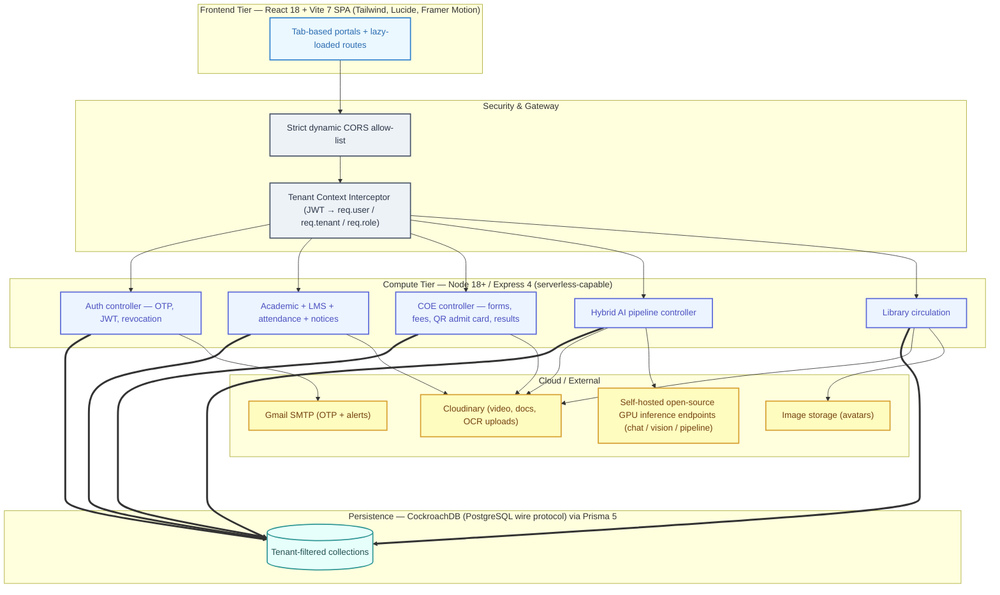

# AmyLearn — Reverse-Engineering Build Specification

> **Purpose:** This document is a self-contained blueprint. Feed it to any capable coding agent
> (or developer) and it will rebuild the **AmyLearn** platform from scratch, feature-for-feature,
> with the same architecture, same API surface, same data model, same design system and same
> UX behaviours.
>
> **Naming rule:** The product is named **AmyLearn** everywhere. No other product name, company
> name, founder name, institution name, domain, repository URL or deployment URL from any prior
> version of this system may appear anywhere in the new codebase, docs, emails, assets,
> environment files or git history. See §12 for the zero-trace acceptance checklist.

---

## Table of Contents

1. [Product Overview](#1-product-overview)
2. [Architecture](#2-architecture)
3. [Repository Layout](#3-repository-layout)
4. [Tech Stack & Versions](#4-tech-stack--versions)
5. [Environment Variables](#5-environment-variables)
6. [Backend Specification](#6-backend-specification)
7. [Database Schema (Prisma)](#7-database-schema-prisma)
8. [API Surface](#8-api-surface)
9. [Frontend Specification](#9-frontend-specification)
10. [Seeding & Demo Data](#10-seeding--demo-data)
11. [Deployment](#11-deployment)
12. [Zero-Trace Acceptance Checklist](#12-zero-trace-acceptance-checklist)
13. [Build Verification Checklist](#13-build-verification-checklist)

---

## 1. Product Overview

**AmyLearn** is a multi-tenant SaaS academic platform for higher-education institutions. One
deployment serves many colleges ("tenants"), each identified by a **college code**. It unifies:

| # | Domain | Capabilities |
|---|--------|--------------|
| 1 | **Multi-tenant auth** | OTP registration via Gmail SMTP, JWT sessions with server-side revocation, logical tenant isolation at query time via a tenant-context interceptor, dual portals (campus side vs. platform side) |
| 2 | **Academic core** | Departments → Streams → Subjects hierarchy, semester *and* trimester curriculum configs, batches, physical classrooms, dynamic rosters (roll-range / ID-sequence / manual enrollment) |
| 3 | **Examinations (COE)** | Eligibility checks by term structure, exam form submission (regular + backlog), fee ledger, QR-coded admit cards, bulk marks upload, publish/unpublish results, semester feedback |
| 4 | **LMS** | Lecture modules grouped by topic, documents + videos, per-content download toggle, completion tracking, Cloudinary-hosted streaming |
| 5 | **Library** | Physical circulation (14-day loans, ₹10/day overdue fine, automated e-mail alerts), digital resource vault with admin approval workflow, encrypted library credentials |
| 6 | **SaaS feature flags** | Platform-level and per-tenant menu/feature toggles, per-role visibility |
| 7 | **Hybrid AI pipeline** | Socratic tutor mode, Mermaid mind-map generation, multimodal file summarisation (PDF/DOCX/XLSX/PPTX/image OCR), lecture video breakdown — served by a self-hosted open-source GPU pipeline |
| 8 | **Notices & calendar** | Staff/departmental notices with reactions + threaded comments, personal + organisation calendars, weekly lesson tracker |
| 9 | **Attendance & timetable** | Faculty daily marking, student self-view, weekly reports, batch routines with periods |

### Roles

| Role (DB value) | Frontend display value | Scope |
|---|---|---|
| `student` | `student` / `campus_student` | Tenant-bound |
| `faculty` | `faculty` | Tenant-bound |
| `college_admin` | `campus_admin` | Tenant-bound (institution owner) |
| `it_user` | `amylearn_manager` | Global (operations) |
| `it_admin` | `amylearn_admin` | Global (platform super-admin) |

> **Important:** only the two platform roles carry a brand-derived prefix — declare them as
> `amylearn_admin` and `amylearn_manager` in the `UserRole` enum. Every other enum value is
> brand-neutral and stays generic.

---

## 2. Architecture



**Key architectural rules (do not deviate):**

1. **Tenant isolation is logical, not physical.** A `setTenantContext` middleware resolves the
   JWT → user → active membership → tenant and every query filters by `tenantId`.
2. **The frontend is a tab-based SPA per portal.** Module navigation is `activeTab` state, not
   URL routes (except top-level pages).
3. **One Axios instance** carries auth + tenant headers for the whole app.
4. **The backend exports its Express `app`** for serverless use and only calls `listen()` when
   not in production (or when `PORT` is explicitly set).

---

## 3. Repository Layout

```
amylearn/
├── AMYLEARN_REVERSE_ENGINEERING_SPEC.md   <- this file
├── README.md                              <- product readme (AmyLearn branding only)
├── vercel.json                            <- SPA rewrite rules
├── backend/
│   ├── package.json                       name: "amylearn-backend"
│   ├── server.js                          app bootstrap, CORS, rate limits, route mounting, crons
│   ├── .env.example
│   ├── vercel.json                        @vercel/node build + crons
│   ├── Dockerfile
│   ├── seed_campus.js                     demo tenant seed
│   ├── config/
│   │   ├── db.js                          Prisma connect helper
│   │   ├── prisma.js                      PrismaClient singleton
│   │   ├── cloudinary.js
│   │   ├── systemRoles.js                 DB role ↔ frontend role mapping
│   │   └── masterFeatures.js              per-role feature/menu catalogue
│   ├── middleware/
│   │   ├── authMiddleware.js              setTenantContext, setITContext
│   │   ├── requireAdminRole.js
│   │   └── validateMiddleware.js          zod validation
│   ├── controllers/
│   │   ├── authController.js              OTP, signup, signin, token blacklist
│   │   ├── itAdminController.js           platform-side tenant CRUD, feature flags, roles
│   │   ├── collegeAdminRoleController.js  campus admin role assignment
│   │   ├── academicController.js          departments, streams, subjects, rosters
│   │   ├── coeController.js               exam sessions, forms, marks, results, feedback
│   │   ├── admitCardController.js         QR admit card data assembly
│   │   ├── aiController.js                chat / summarize-file / transcribe-video
│   │   ├── attendanceController.js        marking, reports, weekly reports
│   │   ├── lmsController.js               modules, content, download toggle, completion
│   │   ├── libraryController.js           digital + physical circulation
│   │   ├── leaveController.js             leave apply / approve
│   │   └── questionBankController.js      question bank upload
│   ├── routes/                            17 route modules (see §8)
│   ├── services/
│   │   ├── emailService.js                nodemailer Gmail transporter
│   │   ├── openSourceAiService.js         GPU chat / vision / multimodal calls
│   │   ├── fileParserService.js           pdf, docx, xlsx, pptx, scanned-OCR extraction
│   │   ├── ocrService.js                  tesseract.js fallback OCR
│   │   └── dbKeepAliveService.js          weekly ping + scheduler
│   ├── templates/emailTemplates.js        HTML email templates
│   ├── utils/
│   │   ├── crypto.js                      AES-256-GCM encrypt/decrypt
│   │   ├── cloudinaryHelper.js
│   │   ├── userDTO.js                     safe user payload shaping
│   │   └── validators.js                  zod schemas
│   ├── prisma/schema.prisma               see §7
│   ├── prisma/migrations/0_init/
│   └── scripts/                           seed + e2e smoke scripts
└── frontend/
    ├── package.json                       name: "amylearn-frontend"
    ├── index.html                         fonts + meta (AmyLearn title)
    ├── vite.config.js                     alias @ → ./src, proxy /api → :4000, manualChunks
    ├── tailwind.config.cjs                LOCKED design tokens
    ├── postcss.config.cjs
    ├── vercel.json
    ├── public/
    └── src/
        ├── main.jsx                       Provider order (locked)
        ├── App.jsx                        Route table + ErrorBoundary (locked)
        ├── index.css                      Global font rules (locked)
        ├── styles/tokens.css              CSS custom properties (locked)
        ├── context/                       Auth, Toast, Theme, ErrorPopup
        ├── hooks/useAuth.js
        ├── utils/config.js                Axios instance (locked)
        ├── utils/apiEndpoints.js          centralised endpoint map
        ├── services/mockAiService.js      offline trial AI responses
        ├── assets/                        AmyLearn logos/SVGs
        ├── components/
        │   ├── global/                    Logo, Footer, GlassHeader, FullScreenMenu, ScrollToTop
        │   ├── common/                    reusable widgets (players, viewers, calendar, PDF)
        │   ├── ui/                        AppLoader, Button, Card, Badge
        │   └── ai/                        AI drawer + AI surface component
        └── pages/
            ├── landing/                   full marketing landing (sections, FAQ, ROI calc)
            ├── LandingPage.jsx            legacy landing
            ├── college-select/            institution picker
            ├── auth/
            │   ├── campus/CampusLogin.jsx
            │   ├── campus-admin/          portal + constants + tabs + skeletons
            │   ├── campus-student/        portal + constants + tabs + viewers
            │   └── it-admin/              portal + constants + tabs + skeletons
            ├── public/                    for-students, for-institutions, terms, privacy
            ├── errors/                    NotFound, SessionExpired, InstitutionError
            └── *.jsx                      legacy standalone modules (still routed)
```

Approximate scale: **17 backend route modules / 12 controllers / 3.8k LOC backend**, **~145
frontend source files**, 3 portal dashboards with ~60 tab components total.

---

## 4. Tech Stack & Versions

### Backend

| Concern | Choice | Version |
|---|---|---|
| Runtime | Node.js | ≥ 18 |
| HTTP | Express | ^4.18.2 |
| ORM | Prisma + `@prisma/client` | ^5.22.0, `provider = "cockroachdb"` |
| DB | CockroachDB Serverless (PostgreSQL wire, port `26257`, `sslmode=verify-full`) | — |
| Auth | `jsonwebtoken` + `bcryptjs` (10 rounds) | ^9 / ^2 |
| Validation | `zod` | ^4 |
| Security | `helmet`, `express-rate-limit`, `cors`, `cookie-parser` | helmet 8, rate-limit 8 |
| Email | `nodemailer` (Gmail service) | ^8 |
| Uploads | `multer` (memory) + `multer-storage-cloudinary`, `cloudinary` | 2 / 4 / 1 |
| Media | `fluent-ffmpeg` + `ffmpeg-static`, `sharp` | — |
| Parsing | `pdf-parse`, `mammoth`, `exceljs`, `officeparser`, `docx` | — |
| OCR | `tesseract.js` | ^7 |
| Misc | `axios`, `adm-zip`, `youtube-transcript`, `@sendgrid/mail`, `@google/generative-ai` (optional fallbacks) | — |
| Dev | `nodemon` | ^3 |

### Frontend

| Concern | Choice | Version |
|---|---|---|
| Framework | React + Vite | React ^18.3.1, Vite ^7, `@vitejs/plugin-react` ^4 |
| Router | `react-router-dom` | ^6.14.1 |
| Styling | Tailwind CSS + PostCSS + Autoprefixer | ^3.4.7 |
| Icons | `lucide-react` | ^0.271.0 |
| Motion | `framer-motion` | ^10.12.16 |
| HTTP | `axios` | ^1.13.2 |
| Markdown/mermaid | `react-markdown` ^10, `mermaid` ^11, `dompurify` ^3 | — |
| PDF/print/QR | `jspdf` ^4, `jspdf-autotable` ^5, `react-pdf` ^10, `react-to-print` ^3, `react-qr-code` ^2, `react-barcode` ^1.6 | — |
| Media | `react-player` ^3 | — |
| Utils | `date-fns` ^4, `lodash` ^4, `uuid` | — |
| Fonts | **Plus Jakarta Sans** (body) + **Jost** (display) via Google Fonts, plus Material Symbols Outlined | — |

---

## 5. Environment Variables

### `backend/.env.example`

```env
# ===== AmyLearn Backend — Environment Variables =====
# Copy to .env and fill in. NEVER commit .env.

# --- CockroachDB (PostgreSQL wire-compatible) ---
DATABASE_URL="postgresql://<user>:<password>@<cluster-host>:26257/<dbname>?sslmode=verify-full"

# --- JWT (REQUIRED — long random string) ---
JWT_SECRET=your_very_long_random_secret_here

# Optional at-rest encryption key for sensitive library credentials (AES-256-GCM).
# Falls back to JWT_SECRET; in production one of the two MUST be set.
ENCRYPTION_KEY=your_at_rest_encryption_key

# --- Server ---
PORT=4000
NODE_ENV=development

# --- Email (Nodemailer / Gmail App Password) ---
EMAIL_USER=your_gmail@gmail.com
EMAIL_PASS=your_gmail_app_password

# --- Cloudinary (file/image/video uploads) ---
CLOUDINARY_CLOUD_NAME=your_cloud_name
CLOUDINARY_API_KEY=your_cloudinary_api_key
CLOUDINARY_API_SECRET=your_cloudinary_api_secret

# --- Open-source AI pipeline (self-hosted GPU endpoints) ---
MODAL_CHAT_URL=https://<your-gpu-host>/<deployment>-chat.endpoint
MODAL_VISION_URL=https://<your-gpu-host>/<deployment>-vision.endpoint
MODAL_PIPELINE_URL=https://<your-gpu-host>/<deployment>-pipeline.endpoint
MODAL_API_KEY=your_gpu_gateway_api_key
MODAL_TIMEOUT_MS=30000

# --- Cron protection (Vercel crons) ---
CRON_SECRET=your_cron_shared_secret

# --- Optional provider fallbacks ---
GEMINI_API_KEY=
CLOUDFLARE_ACCOUNT_ID=
CLOUDFLARE_API_TOKEN=
```

### `frontend/.env`

```env
VITE_API_BASE=http://localhost:4000
```

---

## 6. Backend Specification

### 6.1 `server.js` bootstrap order (exact)

1. `require('dotenv').config()`; import route modules and `setTenantContext`.
2. `connectDB()` (Prisma connect).
3. **Rate limiters**
   - `authRateLimiter`: 15 min window, **max 10**, standard headers on, legacy off, JSON error message
     `"Too many authentication attempts. Please try again in 15 minutes."`
   - `aiRateLimiter`: 60 s window, **max 15**, message `"Too many AI requests. Please slow down."`
4. `helmet({ contentSecurityPolicy: false, crossOriginEmbedderPolicy: false })`.
5. `express.json()`, `cookieParser()`.
6. **Proxy token bridge** — copy `x-user-token` / `x-authorization` request headers into
   `Authorization` (prefixing `Bearer ` if missing) so a reverse proxy can forward the session.
7. **CORS allow-list** (function form, `credentials: true`):
   - no `origin` header → allow (Postman / native clients)
   - exact match of `http://localhost:3000`, `http://localhost:5173`, the production frontend
     origin, and the frontend alpha origin
   - preview regex: `^https://amylearn(?:-frontend)?-[a-z0-9-]+\.vercel\.app$`
   - any `http://localhost|127.0.0.1:<port>` → always allow
   - in non-production, private ranges `192.168.x.x`, `10.x.x.x`, `172.16–31.x.x` → allow
   - preview-host regex: `^https://[a-z0-9-]+\.hf\.space$`
   - mobile schemes: `^(?:exp|amylearn):\/\/`
   - everything else → `callback(new Error('Blocked by CORS policy'), false)`
8. Static mount: `app.use('/webdata', express.static(<repo>/webdata))`.
9. **Route mounts** (table in §8.2), with rate limiters and `setTenantContext` exactly as listed.
10. **Cron endpoints** mounted *before* the `/api` catch-all routers:
    - `GET /api/cron/cleanup` — requires `Authorization: Bearer CRON_SECRET` or `?secret=`.
      Deletes expired `EmailVerification` rows and `PhysicalBook` rows past `deleteAfter`, then
      scans `BookCopy` with `status='Issued'` and `dueDate < now`, emails each borrower
      (`fine = daysOverdue * 10`) and returns `{ success, emailCleaned, booksCleaned, overdueAlertsSent }`.
    - `GET /api/cron/db-keep-alive` — same secret check, returns `pingDatabase()` result.
11. Remaining `/api` mounts: timetable, LMS, library, attendance.
12. `GET /health` (optional `?db=true` for a live DB ping) and a Google site-verification route.
13. `app.listen` only when `NODE_ENV !== 'production' || process.env.PORT`; start the weekly
    keep-alive job inside the listen callback. `module.exports = app` for serverless.

### 6.2 Auth flow

```
POST /api/auth/check-email          → is the address already registered?
POST /api/auth/send-verification     → 6-digit code, persisted in EmailVerification (TTL), emailed
POST /api/auth/verify-email          → validate code, mark verified
POST /api/auth/role-signup           → bcrypt.hash(password, 10); create User + profile + Membership
POST /api/auth/signin                → bcrypt.compare; jwt.sign({ userId, tenantId, role, ... })
POST /api/auth/signout               → add token to in-memory revocation blacklist (SystemConfig-backed)
GET  /api/auth/verify-token          → validate a presented token
GET  /api/auth/public/colleges       → public tenant list for the picker page
PATCH /api/auth/change-password      → verify current, hash new
```

**Token rules:** JWT signed with `JWT_SECRET`; the token is delivered both as
`localStorage.token` (campus portals) / `localStorage.it_token` (platform portal) and as an
`httpOnly`-style `sessionToken` cookie where used. Every protected request re-verifies the JWT,
checks the **revocation blacklist** (401 `"Session expired. Please sign in again."` if revoked),
loads the user, and resolves an active `Membership`.

**Middleware outputs:**

| Middleware | Mount | Sets |
|---|---|---|
| `setTenantContext` | `/api/college-admin`, `/api/student`, `/api/ai` | `req.user {id,name,email}`, `req.tenant {id,name,type,logoUrl,collegeCode}`, `req.role` (membership role, else user role), `req.adminRoles`, `req.isSuperAdmin` |
| `setITContext` | platform routes | `req.itUser {id,name,email,role(frontend-mapped),originalRole}` |

Super-admin roles constant: `['super_admin','it_admin','amylearn_admin','amylearn_manager']`.

### 6.3 Session TTLs (frontend-enforced)

| Portal | localStorage key | TTL |
|---|---|---|
| Platform admin | `amylearn_it_session` | 8 h |
| Campus admin | `amylearn_campus_admin_session` | 12 h |
| College (faculty/student legacy) | `amylearn_college_session` | 24 h |
| Campus student | `amylearn_student_session` | 24 h |
| Selected tenant | `selected_college` | — |
| JWTs | `token`, `it_token` | — |

On any 401 the Axios response interceptor dispatches
`window.dispatchEvent(new CustomEvent('amylearn-session-expired'))`.

### 6.4 Config modules

- **`config/systemRoles.js`** — `DB_ROLES { SUPER_ADMIN:'it_admin', MANAGER:'it_user' }`,
  `FRONTEND_ROLES { SUPER_ADMIN:'amylearn_admin', MANAGER:'amylearn_manager' }`, `ROLE_MAP`,
  `ROLE_CONFIG` with ID prefixes `ADM` / `MGR`, profile models `ITAdminProfile` / `ITUserProfile`,
  default departments `System Administration` / `IT Support`.
- **`config/masterFeatures.js`** — a `{ student: [...], faculty: [...], college_admin: [...] }`
  catalogue where each entry is `{ key, title, icon (lucide name), description }`. Student keys:
  `courses, assignments, attendance, library, dept_notices, org_calendar, payment_details, fees,
  update_info, results, feedback, exam_form, timetable, admit_card`. Faculty keys:
  `my_classes, attendance_marking, upload_marks, upload_content, question_bank, library,
  leave_apply, dept_notices, staff_notices, coe_manage, org_calendar, timetable`. Admin keys:
  `staff_notices, settings, leave_manager, library, approvals, timetable, org_calendar,
  manage_users, account_creation, fees_exam_records, manage_departments, admin_roles, coe_manage,
  exam_management, university_marks`. Titles must read *"<Product> College Settings"* style only
  where the original had brand text — use **"AmyLearn College Settings"**.
- **`utils/crypto.js`** — AES-256-GCM; key = `sha256(ENCRYPTION_KEY || JWT_SECRET)`; in
  development only, a hardcoded fallback key string is allowed — use
  `'developer-fallback-secret-key-amylearn'`. Ciphertext format `iv:authTag:encryptedText`,
  IV length 12.

### 6.5 Services

| Service | Behaviour |
|---|---|
| `emailService.js` | Single module-level `nodemailer.createTransport({ service:'gmail' })`; `sendEmail(email, code)` sends `"AmyLearn" <EMAIL_USER>` / subject `"AmyLearn - Sign Up Email Verification Code"`; also `sendOverdueBookEmail(...)` using `getOverdueBookAlertHtml` |
| `openSourceAiService.js` | Bearer-authenticated POSTs to `MODAL_CHAT_URL` / `MODAL_VISION_URL` / `MODAL_PIPELINE_URL` with `MODAL_TIMEOUT_MS` (default 30000). Exports `generateTutorResponse(systemInstruction, message, maxTokens, temperature)`, `extractVisualContext(imageBufferOrBase64, instruction)` (vision model; instruction extracts text, formulas, equations, tables, handwriting and describes charts), `processMultimodalInput({ imageBuffer, taskType, userPrompt, studentName })`. Missing key → request-time error, never a boot crash. |
| `fileParserService.js` | `extractTextFromPdf/Docx/Excel/Pptx`, plus `extractTextFromScannedPdf/Docx` that run OCR and return the sentinel `"LIMIT_EXCEEDED"` when the document exceeds the page cap |
| `ocrService.js` | `tesseract.js` fallback used by the scanned parsers |
| `dbKeepAliveService.js` | `pingDatabase()` + `startWeeklyKeepAliveJob()` (nominal weekly query so a free-tier cluster never sleeps) |

### 6.6 AI controller contract

`POST /api/ai/chat` body `{ message, context:{ userName, classroomName }, mode }`

| `mode` | System instruction summary |
|---|---|
| `tutor` | Socratic tutor: guide step-by-step, never reveal answers immediately, ask clarifying questions, friendly and motivating |
| `mindmap` | Mermaid.js `graph TD` generator returning **only** the code block |
| default | Supportive study companion, clear concise markdown explanations, personalised with the student's name |

- Reply for `mindmap` is wrapped as `:::MERMAID_Start::<code>:::MERMAID_End:::` after
  `cleanMermaidCode()` strips fences, repairs `|>` → `|`, and prepends `graph TD` when missing.
- AI failure → HTTP 500 with a friendly `reply` string telling the user the GPU service is offline.

`POST /api/ai/summarize-file` — multipart, `taskType ∈ {summarize, solve, exam_quiz, mindmap}`:
- **Image** → `sharp` resize to ≤1024×1024, JPEG q80 → multimodal pipeline.
- **PDF/DOCX** → digital text first; if < 100 chars, run OCR and merge both sources under
  `--- [Source: Digital Parse] ---` / `--- [Source: Visual OCR] ---` headers.
- **XLSX / PPTX / TXT** → direct extraction.
- Text truncated to **16000** chars; response `{ summary }`; `mindmap` wrapped in the MERMAID sentinel.

`POST /api/ai/transcribe-video` — body `{ videoUrl }`; returns a structured lecture breakdown:
core topic summary, key takeaways/definitions/formulas, and 3 review questions.

---

## 7. Database Schema (Prisma)

`backend/prisma/schema.prisma` — `provider = "cockroachdb"`, `url = env("DATABASE_URL")`,
generator `prisma-client-js`. Table names are snake_case via `@@map`. Reproduce **exactly**:

```prisma
generator client {
  provider = "prisma-client-js"
}

datasource db {
  provider = "cockroachdb"
  url      = env("DATABASE_URL")
}

enum UserRole {
  student
  faculty
  college_admin
  it_user
  it_admin
  amylearn_manager
  amylearn_admin
}

enum TenantType { college individual }
enum TenantStatus { active suspended }
enum MembershipStatus { active suspended }

model User {
  id                  String    @id @default(uuid())
  amylearnId          String?   @unique
  email               String    @unique
  name                String
  password            String
  emailVerified       Boolean   @default(true)
  deletionScheduledAt DateTime?
  createdAt           DateTime  @default(now())
  role                UserRole  @default(student)
  department          String    @default("General")
  college             String?

  memberships          Membership[]
  studentProfiles      StudentProfile[]
  facultyProfiles      FacultyProfile[]
  adminProfiles        AdminProfile[]
  itUserProfiles       ITUserProfile[]
  itAdminProfiles      ITAdminProfile[]
  notices              Notice[]           @relation("PosterNotices")
  leaveApplications    LeaveApplication[] @relation("ApplicantLeaves")
  digitalResources     DigitalResource[]
  physicalBooksIssued  BookCopy[]         @relation("BookIssuedTo")
  attendanceRecords    AttendanceRecord[] @relation("StudentAttendance")
  markedAttendances    Attendance[]       @relation("FacultyAttendance")
  routines             RoutinePeriod[]    @relation("FacultyRoutines")
  weeklyReports        WeeklyReport[]

  @@map("users")
}

model Tenant {
  id                  String       @id @default(uuid())
  name                String       @unique
  type                TenantType   @default(college)
  subdomain           String?
  logoUrl             String?
  collegeCode         String?      @unique
  location            String       @default("India")
  category            String       @default("University")
  featured            Boolean      @default(false)
  status              TenantStatus @default(active)
  createdAt           DateTime     @default(now())
  deletionScheduledAt DateTime?

  memberships       Membership[]
  departments       Department[]
  subjects          Subject[]
  batches           Batch[]
  classrooms        Classroom[]
  notices           Notice[]
  leaveApplications LeaveApplication[]
  digitalResources  DigitalResource[]
  physicalBooks     PhysicalBook[]
  credentials       LibraryCredential[]
  routines          Routine[]
  attendances       Attendance[]
  weeklyReports     WeeklyReport[]
  examSessions      ExamSession[]
  examResults       ExamResult[]

  @@map("tenants")
}

model Membership {
  id       String           @id @default(uuid())
  userId   String
  tenantId String
  role     UserRole
  status   MembershipStatus @default(active)
  joinedAt DateTime         @default(now())

  user   User   @relation(fields: [userId], references: [id], onDelete: Cascade)
  tenant Tenant @relation(fields: [tenantId], references: [id], onDelete: Cascade)

  @@unique([userId, tenantId])
  @@index([userId, tenantId])
  @@index([tenantId, role])
  @@map("memberships")
}

model StudentProfile {
  id           String   @id @default(uuid())
  userId       String   @unique
  tenantId     String
  rollNumber   String?
  batchId      String?
  departmentId String?
  createdAt    DateTime @default(now())
  user User @relation(fields: [userId], references: [id], onDelete: Cascade)
  @@map("student_profiles")
}

model FacultyProfile {
  id           String   @id @default(uuid())
  userId       String   @unique
  tenantId     String
  employeeId   String?
  departmentId String?
  designation  String?
  createdAt    DateTime @default(now())
  user User @relation(fields: [userId], references: [id], onDelete: Cascade)
  @@map("faculty_profiles")
}

model AdminProfile {
  id        String   @id @default(uuid())
  userId    String   @unique
  tenantId  String
  createdAt DateTime @default(now())
  user User @relation(fields: [userId], references: [id], onDelete: Cascade)
  @@map("admin_profiles")
}

model ITUserProfile {
  id        String   @id @default(uuid())
  userId    String   @unique
  createdAt DateTime @default(now())
  user User @relation(fields: [userId], references: [id], onDelete: Cascade)
  @@map("it_user_profiles")
}

model ITAdminProfile {
  id        String   @id @default(uuid())
  userId    String   @unique
  createdAt DateTime @default(now())
  user User @relation(fields: [userId], references: [id], onDelete: Cascade)
  @@map("it_admin_profiles")
}

model Department {
  id               String   @id @default(uuid())
  tenantId         String
  name             String
  code             String?
  headOfDepartment String?
  createdAt        DateTime @default(now())
  tenant   Tenant   @relation(fields: [tenantId], references: [id], onDelete: Cascade)
  subjects Subject[]
  streams  Stream[]
  @@map("departments")
}

model Stream {
  id             String  @id @default(uuid())
  departmentId   String
  name           String
  code           String?
  isConfigured   Boolean @default(false)
  isLocked       Boolean @default(false)
  curriculumType String  @default("Semester")
  totalTerms     Int     @default(8)
  oddStartMonth  String  @default("July")
  oddEndMonth    String  @default("December")
  evenStartMonth String  @default("January")
  evenEndMonth   String  @default("June")
  department Department @relation(fields: [departmentId], references: [id], onDelete: Cascade)
  @@map("streams")
}

model Subject {
  id           String   @id @default(uuid())
  tenantId     String
  departmentId String
  name         String
  code         String
  type         String   @default("Theory")
  credits      Int      @default(3)
  semester     Int
  year         Int
  isActive     Boolean  @default(true)
  createdAt    DateTime @default(now())
  tenant     Tenant     @relation(fields: [tenantId], references: [id], onDelete: Cascade)
  department Department @relation(fields: [departmentId], references: [id], onDelete: Cascade)
  routines   RoutinePeriod[]
  attendances Attendance[]
  @@unique([tenantId, code])
  @@map("subjects")
}

model Batch {
  id           String   @id @default(uuid())
  tenantId     String
  name         String
  startYear    Int
  endYear      Int
  departmentId String?
  createdAt    DateTime @default(now())
  tenant      Tenant         @relation(fields: [tenantId], references: [id], onDelete: Cascade)
  routines    Routine[]
  attendances Attendance[]
  weeklyReports WeeklyReport[]
  @@map("batches")
}

model Classroom {
  id         String  @id @default(uuid())
  tenantId   String
  roomNumber String
  building   String?
  capacity   Int?
  createdAt  DateTime @default(now())
  tenant Tenant @relation(fields: [tenantId], references: [id], onDelete: Cascade)
  @@map("classrooms")
}

model ClassModule {
  id          String  @id @default(uuid())
  subjectId   String
  title       String
  description String?
  orderNumber Int     @default(1)
  createdAt   DateTime @default(now())
  contents ClassContent[]
  @@map("class_modules")
}

model ClassContent {
  id        String  @id @default(uuid())
  moduleId  String
  title     String
  type      String  @default("Video")
  url       String
  duration  String?
  createdAt DateTime @default(now())
  module ClassModule @relation(fields: [moduleId], references: [id], onDelete: Cascade)
  @@map("class_contents")
}

model Notice {
  id         String   @id @default(uuid())
  tenantId   String
  type       String   // 'staff' | 'departmental'
  department String?
  category   String   @default("Announcement")
  posterId   String
  posterName String?
  posterRole String?
  title      String
  content    String
  createdAt  DateTime @default(now())
  updatedAt  DateTime @default(now())
  tenant   Tenant         @relation(fields: [tenantId], references: [id], onDelete: Cascade)
  poster   User           @relation("PosterNotices", fields: [posterId], references: [id], onDelete: Cascade)
  comments NoticeComment[]
  reactions NoticeReaction[]
  @@map("notices")
}

model NoticeComment {
  id        String   @id @default(uuid())
  noticeId  String
  userId    String
  userName  String?
  text      String
  parentId  String?
  createdAt DateTime @default(now())
  notice Notice @relation(fields: [noticeId], references: [id], onDelete: Cascade)
  @@map("notice_comments")
}

model NoticeReaction {
  id       String @id @default(uuid())
  noticeId String
  userId   String
  userName String?
  notice   Notice @relation(fields: [noticeId], references: [id], onDelete: Cascade)
  @@map("notice_reactions")
}

model LeaveApplication {
  id          String    @id @default(uuid())
  tenantId    String
  applicantId String
  type        String    // 'Casual' | 'Medical' | ...
  startDate   DateTime
  endDate     DateTime
  reason      String
  status      String    @default("Pending") // Pending | Approved | Rejected
  approvedBy  String?
  actionedAt  DateTime?
  createdAt   DateTime  @default(now())
  tenant    Tenant @relation(fields: [tenantId], references: [id], onDelete: Cascade)
  applicant User   @relation("ApplicantLeaves", fields: [applicantId], references: [id], onDelete: Cascade)
  @@map("leave_applications")
}

model LibraryCredential {
  id           String   @id @default(uuid())
  tenantId     String
  providerName String
  loginId      String   // stored AES-256-GCM encrypted
  password     String   // stored AES-256-GCM encrypted
  link         String?
  note         String?
  updatedAt    DateTime @default(now())
  tenant Tenant @relation(fields: [tenantId], references: [id], onDelete: Cascade)
  @@map("library_credentials")
}

model DigitalResource {
  id          String    @id @default(uuid())
  tenantId    String
  title       String
  author      String
  department  String
  course      String?
  type        String    @default("Notes")
  url         String
  description String?
  semester    Int       @default(1)
  status      String    @default("Approved") // Pending | Approved | Rejected
  addedById   String?
  deleteAfter DateTime?
  createdAt   DateTime  @default(now())
  tenant   Tenant       @relation(fields: [tenantId], references: [id], onDelete: Cascade)
  addedBy  User?        @relation(fields: [addedById], references: [id], onDelete: SetNull)
  @@map("digital_resources")
}

model PhysicalBook {
  id          String    @id @default(uuid())
  tenantId    String
  title       String
  author      String
  isbn        String?
  category    String?
  baseId      String
  deleteAfter DateTime?
  tenant Tenant     @relation(fields: [tenantId], references: [id], onDelete: Cascade)
  copies BookCopy[]
  @@map("physical_books")
}

model BookCopy {
  id         String    @id @default(uuid())
  bookId     String
  copyId     String    @unique
  status     String    @default("Available") // Available | Issued | Lost
  issuedToId String?
  issuedDate DateTime?
  dueDate    DateTime?
  book     PhysicalBook @relation(fields: [bookId], references: [id], onDelete: Cascade)
  issuedTo User?        @relation("BookIssuedTo", fields: [issuedToId], references: [id], onDelete: SetNull)
  @@map("book_copies")
}

model Routine {
  id        String   @id @default(uuid())
  tenantId  String
  batchId   String
  dayOfWeek String
  tenant  Tenant          @relation(fields: [tenantId], references: [id], onDelete: Cascade)
  batch   Batch           @relation(fields: [batchId], references: [id], onDelete: Cascade)
  periods RoutinePeriod[]
  @@map("routines")
}

model RoutinePeriod {
  id           String  @id @default(uuid())
  routineId    String
  periodNumber Int
  subjectId    String?
  facultyId    String?
  startTime    String?
  endTime      String?
  routine Routine  @relation(fields: [routineId], references: [id], onDelete: Cascade)
  subject Subject? @relation(fields: [subjectId], references: [id], onDelete: SetNull)
  faculty  User?   @relation("FacultyRoutines", fields: [facultyId], references: [id], onDelete: SetNull)
  @@map("routine_periods")
}

model Attendance {
  id           String   @id @default(uuid())
  tenantId     String
  date         DateTime
  batchId      String
  periodId     String?
  subjectId    String
  facultyId    String
  isFinalized  Boolean  @default(true)
  markedAt     DateTime @default(now())
  tenant  Tenant             @relation(fields: [tenantId], references: [id], onDelete: Cascade)
  batch   Batch              @relation(fields: [batchId], references: [id], onDelete: Cascade)
  subject Subject            @relation(fields: [subjectId], references: [id], onDelete: Cascade)
  faculty User               @relation("FacultyAttendance", fields: [facultyId], references: [id], onDelete: Cascade)
  records AttendanceRecord[]
  @@map("attendances")
}

model AttendanceRecord {
  id           String @id @default(uuid())
  attendanceId String
  studentId    String
  status       String @default("Present") // Present | Absent | Late
  attendance Attendance @relation(fields: [attendanceId], references: [id], onDelete: Cascade)
  student    User       @relation("StudentAttendance", fields: [studentId], references: [id], onDelete: Cascade)
  @@map("attendance_records")
}

model WeeklyReport {
  id            String   @id @default(uuid())
  tenantId      String?
  batchId       String?
  weekStartDate DateTime
  weekEndDate   DateTime
  generatedById String?
  status        String   @default("Pending")
  createdAt     DateTime @default(now())
  tenant      Tenant? @relation(fields: [tenantId], references: [id], onDelete: Cascade)
  batch       Batch?  @relation(fields: [batchId], references: [id], onDelete: Cascade)
  generatedBy User?   @relation(fields: [generatedById], references: [id], onDelete: SetNull)
  @@map("weekly_reports")
}

model ExamSession {
  id        String   @id @default(uuid())
  tenantId  String
  name      String
  startDate DateTime
  endDate   DateTime
  status    String   @default("Upcoming") // Upcoming | Active | Completed
  tenant Tenant @relation(fields: [tenantId], references: [id], onDelete: Cascade)
  @@map("exam_sessions")
}

model ExamResult {
  id        String   @id @default(uuid())
  tenantId  String
  studentId String
  subjectId String
  marks     Float
  grade     String?
  createdAt DateTime @default(now())
  tenant Tenant @relation(fields: [tenantId], references: [id], onDelete: Cascade)
  @@map("exam_results")
}

model EmailVerification {
  id        String   @id @default(uuid())
  email     String   @unique
  code      String
  expiresAt DateTime
  @@map("email_verifications")
}

model SystemConfig {
  id    String @id @default(uuid())
  key   String @unique
  value String
  @@map("system_configs")
}

model Counter {
  id  String @id @default(uuid())
  key String @unique
  seq Int    @default(0)
  @@map("counters")
}
```

> `Counter` is the allocation sequence generator for human-readable IDs (roll numbers, copy IDs,
> institution codes). `SystemConfig` stores feature-flag snapshots and the token-revocation list.

---

## 8. API Surface

### 8.1 Endpoint registry

Paths are exact. `MW` = middleware applied at mount time.

| Mount | MW | Endpoints |
|---|---|---|
| `/api/auth` | `authRateLimiter` | `POST /check-email`, `POST /send-verification`, `POST /verify-email`, `POST /role-signup`, `POST /signin`, `POST /signout`, `GET /verify-token`, `GET /public/colleges`, `PATCH /change-password` |
| `/it-auth` | `authRateLimiter` | same router as `/it-admin` (login entry alias) |
| `/it-admin` | — | `GET /public/colleges`, `POST /login`, `POST /signout`, `GET|POST /colleges`, `PATCH /colleges/:id/status`, `PUT|DELETE /colleges/:id`, `GET /college-requests`, `GET /manager-requests`, `GET /users`, `GET /tenants-list`, `GET /menu-config/:tenantId`, `POST /menu-config`, `GET|POST /colleges/:id/admins`, `PATCH|DELETE /colleges/:id/admins/:userId`, `GET|POST /global-roles`, `PUT|DELETE /global-roles/:key`, `GET|POST /colleges/:id/custom-roles`, `PATCH /colleges/:id/custom-roles/:roleKey/label`, `DELETE /colleges/:id/custom-roles/:roleKey` |
| `/session` | — | `GET /info`, `GET /menu` |
| `/api/college-admin` | `setTenantContext` | `GET|PATCH /settings`, `GET /my-roles`, `GET /available-roles`, `GET /admin-roles`, `GET /requests`, `POST /requests/:id/:action`, `GET /users/:role`, `PATCH /users/:id/status`, `DELETE /users/:id`, `GET /fees`, `GET /marks` |
| `/api/student` | `setTenantContext` | `GET /dashboard`, `GET /courses`, `GET /admit-card`, `GET /fees`, `GET|POST /exam-form`, `GET|POST /sem-feedback`, `GET|POST /project-info`, `GET /payment-history` |
| `/api/ai` | `authRateLimiter` + `setTenantContext` | `POST /chat`, `POST /summarize-file`, `POST /transcribe-video` |
| `/api/departments` | — | `GET|POST /`, `PUT|DELETE /:id`, `POST /:id/streams`, `PUT /:deptId/streams/:streamId/config`, `DELETE /:id/streams/:streamId`, `GET|POST /:deptId/subjects`, `PUT|DELETE /subjects/:id`, `GET /:id/overview` |
| `/api/classrooms` | — | `GET|POST /`, `POST /:id/enroll`, `DELETE /:id/unenroll`, `DELETE /:id` |
| `/api/batches` | — | `GET|POST /`, `POST /:batchId/enroll`, `GET /my-batches`, `GET /:batchId/students`, `PUT|DELETE /:id` |
| `/api/notices` | — | `GET /`, `GET /:type`, `POST /`, `PATCH /:id/react`, `POST /:id/comments`, `DELETE /:id` |
| `/api/coe` | — | see below |
| `/` (system) | — | `GET /features`, `POST /features`, `GET /dashboard/menu` |
| `/api/leave` | — | `POST /apply`, `GET /faculty`, `GET /history/:userId`, `GET /admin/requests`, `PUT /admin/action/:id` |
| `/api` (timetable) | — | `GET /calendar`, `GET|POST /calendar/events`, `DELETE /calendar/events/:id`, `GET|POST /calendar/org`, `PATCH|DELETE /calendar/org/:id`, `GET|POST /routine/batch/:batchId`, `GET|POST /lessons`, `GET|POST /faculty/schedule` |
| `/api` (LMS) | — | `GET /all-subjects`, `GET|POST /classrooms/:id/modules`, `GET|POST /modules/:moduleId/content`, `GET /content/:id`, `PUT /content/:id/toggle-download`, `POST /content/:id/complete`, `DELETE /content/:id` |
| `/api/library` | — | `GET /digital`, `POST /digital/resource`, `PUT /digital/resource/:id/status`, `PUT|DELETE /digital/credential`, `PUT|DELETE /digital/resource/:id`, `GET /physical`, `GET /physical/user/:identifier`, `GET /physical/copy/:copyId`, `POST /physical/checkout`, `POST /physical/return`, `DELETE /physical/copy/:copyId` |
| `/api/attendance` | — | `GET /faculty/init`, `GET /report`, `GET /my-records`, `GET /my-attendance`, `POST /mark`, `GET /weekly-reports`, `POST /weekly-reports/generate` |

**`/api/coe` (mounted at `/api/coe`):**

```
GET    /sessions/all                 POST   /session                    PUT    /session/:id
GET    /student/eligibility/:studentId               POST   /student/submit-form
GET    /allocation/student/:studentId                GET    /allocation/batch/:batchId
POST   /allocation
POST   /upload-question              GET    /questions                  DELETE /question/:id
GET    /active-session
POST   /submit-exam-form             GET    /my-forms/:studentId
POST   /upload-marks                 POST   /publish-results
GET    /results/:rollNo              GET    /my-results                 GET    /student/results/:userId
GET    /admin/exam-forms             GET    /admin/semester-fees
GET    /admin/exam-status            DELETE /admin/reset-form/:formId
GET    /student/feedback-data/:userId              POST   /student/submit-feedback
GET    /admit-card/:studentUserId    PUT    /student/update-form-payment/:id
GET    /student/payment-history/:userId
```

### 8.2 Domain behaviours to reproduce

**COE / examinations**
- Eligibility is computed from the tenant's curriculum type (semester vs trimester) and term
  cycle; a student sees eligible regular/backlog papers.
- Exam form submission writes an entry into a centralised fee ledger; payment state can be
  toggled by an admin (`update-form-payment`) and history is exposed per student.
- A paid form produces an **admit card** payload rendered client-side as a PDF with a unique
  **QR code** (`react-qr-code`) plus a barcode and an instruction block ("Bring a valid college
  ID along with this admit card.").
- Bulk marks upload → `upload-marks`; publishing toggles student visibility
  (`publish-results`); `reset-form` reopens a submitted form.

**Library**
- Digital: submit a resource → admin review → `status` transitions; approved resources are
  visible to students/faculty. Provider credentials are stored AES-256-GCM encrypted and never
  returned raw.
- Physical: `checkout` sets `status='Issued'`, `issuedDate=now`, `dueDate=now+14 days`;
  `return` clears the issuer. Overdue = `dueDate < now`; fine = `daysOverdue × 10`. A cron job
  emails each overdue borrower.

**LMS**
- Modules belong to a subject; contents belong to a module and carry `type` (Video/Document),
  `url`, `duration`, a per-content **download permission toggle** and a per-student completion
  flag. Videos are hosted on Cloudinary and streamed through a custom player.

**Notices**
- `type` distinguishes `staff` vs `departmental`; posting records poster id/name/role; students
  can react (toggle) and post threaded comments (`parentId`).

**Feature flags**
- `GET/POST /features` maintains the master flag set; `GET /dashboard/menu` returns the
  role-filtered menu for the signed-in user; `POST /menu-config` stores per-tenant overrides
  from the platform portal.

---

## 9. Frontend Specification

### 9.1 Build config (`vite.config.js`)

- Alias `'@' → ./src`.
- `server.port = 5173`, `host: true`, proxy `'/api' → http://localhost:4000`
  (`changeOrigin: true`, `secure: false`).
- `build.sourcemap: false`, `chunkSizeWarningLimit: 1000`.
- `manualChunks` splitting node_modules into `vendor-react`, `vendor-pdf`, `vendor-markdown`,
  `vendor-motion`, `vendor-icons`, `vendor-utils` (axios/date-fns/lodash).

### 9.2 Entry & providers (`main.jsx` — order is locked)

```jsx
<BrowserRouter>
  <ThemeProvider>
    <ErrorPopupProvider>
      <AuthProvider>
        <ToastProvider>
          <App />
        </ToastProvider>
      </AuthProvider>
    </ErrorPopupProvider>
  </ThemeProvider>
</BrowserRouter>
```

`index.html`: `<title>AmyLearn — Unified Academic Platform for Modern Education</title>`,
favicon `/AmyLearn_logo_favicon.png`, description meta, Google Fonts preconnect + the
**Jost / Plus Jakarta Sans** stylesheet and the **Material Symbols Outlined** stylesheet.
`<body class="bg-bg-light text-on-surface font-sans antialiased min-h-screen flex flex-col">`.

### 9.3 Design system

**Fonts:** `font-sans` / `font-jakarta` = Plus Jakarta Sans; `font-display` / `font-jost` = Jost.
A global rule in `index.css` renders every `h1–h6` and `.font-jost` in Jost — never override
with inline styles.

**Tailwind colour tokens (`tailwind.config.cjs`, LOCKED):**

| Token | Hex | Use |
|---|---|---|
| `primary` / `primary-container` | `#004bb0` / `#1e63d6` | M3 primary |
| `secondary` (+container) | `#006a68` / `#68f8f4` | M3 teal |
| `tertiary` (+container) | `#5a1cdd` / `#7342f5` | M3 violet |
| `error` (+container) | `#ba1a1a` / `#ffdad6` | errors |
| `brandBlue` | `#1E63D6` | platform primary brand blue |
| `learningTeal` | `#21C7C4` | accent teal |
| `skyBlue` / `sky-blue` | `#4DA3FF` | highlights |
| `energyOrange` | `#FF8A00` | warnings |
| `deepNavy` | `#0A1F44` | primary text everywhere |
| `innovationViolet` | `#7C4DFF` | AI surfaces |
| `roseGold`, `lavenderLight` | `#F4B6A6`, `#E9E3FF` | decorative |
| `bgLight` / `bg-light` / `bg-dark` | `#F6F8FC` / `#F6F8FC` / `#081221` | page background |
| `surface*` | `#faf9ff`, `#f1f3ff`, `#e9edff`, `#e1e8ff`, `#d9e2ff`, `#111A2E` | cards |
| `on-surface`, `on-surface-variant`, `outline`, `outline-variant` | `#041a3f`, `#424653`, `#737785`, `#c2c6d6` | text/lines |
| `ai-gradient-start/end` | `#7C4DFF` / `#B388FF` | AI gradient |
| `brand` scale 50→900, `ai` scale, `danger` scale, `success` scale | — | compatibility scales |

Fonts config, `maxWidth['container-max'] = 1280px`, spacing `gutter:16px`,
`margin-mobile:16px`, `margin-desktop:32px`, radii `DEFAULT .25rem … 3xl 1.5rem, full 9999px`.

**CSS variables (`src/styles/tokens.css`, LOCKED):** brand core colours
(`--color-brand-blue: #1E63D6`, `--color-learning-teal`, `--color-sky-blue`,
`--color-energy-orange`, `--color-deep-navy`, `--color-innovation-violet`, `--color-rose-gold`,
`--color-lavender-light`, `--color-bg-light`), semantic light-mode
(`--bg-primary:#F6F8FC`, `--bg-surface:#FFF`, `--bg-surface-alt:#EEF3FA`,
`--border-color:#E1E7F0`, `--border-subtle`, `--text-primary:#0A1F44`,
`--text-secondary:#64748B`, `--text-muted:#94A3B8`), gradients
(`--gradient-primary` navy→blue→teal 135°, `--gradient-ai` violet, `--gradient-hero`
blue→sky→violet, `--gradient-rose-gold`), spacing/radii scale, and font variables.

**Utility classes (`index.css`, LOCKED):** `.glass-panel`, `.glass-pill`, `.bento-shadow`,
`.bento-shadow-hover:hover`, `.ai-gradient`, `.ai-gradient-text`, `.primary-gradient`,
`.primary-gradient-text`, `.gradient-mesh`, `.no-scrollbar`.

**Portal palettes (never mixed):**

| Portal | Background | Primary | Card border | Badge |
|---|---|---|---|---|
| Platform admin | `bg-bgLight` / `#F6F8FC` | `bg-brandBlue #1E63D6`, `bg-primary` | `border-slate-200/80` | slate |
| Campus admin | `bg-[#F4F8F8]` | `bg-teal-600/700/800` | `border-teal-100/90` | `bg-teal-100 text-teal-900` |
| Campus student | `bg-[#F5F4FF]` | `bg-indigo-600`, `bg-violet-600` | `border-indigo-100/90` | `bg-indigo-100 text-indigo-900` |

**Standard component patterns (Tailwind):**

```text
Card container      bg-white rounded-2xl border border-<portal>-100/90 shadow-2xs
Card header title   text-xl font-extrabold text-deepNavy font-jost
Description         text-xs text-slate-500 mt-0.5
Badge pill          text-[10px] font-bold bg-<portal>-100 text-<portal>-900 px-2 py-0.5 rounded-full font-mono
Primary button      px-4 py-2 rounded-xl bg-<portal>-700 text-white text-xs font-bold font-jost
Secondary button    px-3.5 py-2 rounded-xl bg-slate-50 border border-slate-200 text-xs font-bold
Filter pill row     bg-slate-100 p-1 rounded-xl with active inner bg-white shadow-2xs
Status active       bg-emerald-50 text-emerald-700 border border-emerald-200
Status inactive     bg-slate-50 text-slate-500 border border-slate-200
```

**Motion:**

```jsx
<motion.div whileHover={{ y: -3, transition: { duration: 0.15 } }}>            // card lift
<motion.div initial={{opacity:0,y:12}} animate={{opacity:1,y:0}}
             transition={{duration:0.3}}>                                       // tab entrance
<motion.div initial={{opacity:0,x:-8}} animate={{opacity:1,x:0}}
             transition={{delay:index*0.04}}>                                   // staggered list
```

### 9.4 Axios client (`utils/config.js`, LOCKED)

```js
export const API_BASE = import.meta.env.VITE_API_BASE || 'http://localhost:4000';
export const COLLEGE_CONFIG = {
  logoUrl: '/webdata/clg-logo/AmyLearn_demo.png',
  collegeName: '<Demo Institution Name>',
  brandName: 'AmyLearn',
  supportEmail: 'support@amylearn.app'
};
export const api = axios.create({ baseURL: API_BASE, withCredentials: true,
  headers: { 'Content-Type': 'application/json' } });
```

- **Request interceptor:** attach `Authorization: Bearer <token>` and `x-user-token: <token>`
  from `localStorage.token ?? localStorage.it_token`; attach `x-tenant-id` parsed from
  `localStorage.selected_college`.
- **Response interceptor:** on `401` dispatch `amylearn-session-expired`.
- `utils/apiEndpoints.js` mirrors every backend path under grouped constants
  (`AUTH`, `IT_ADMIN`, `CAMPUS_ADMIN`, `STUDENT`, `ATTENDANCE`, `AI`, `LIBRARY`, `COE`, …).

### 9.5 Contexts

| Context | Contract |
|---|---|
| `AuthContext` | Source of truth for sessions. Manages `itSession`, `campusAdminSession`, `collegeSession`, `studentSession` + `user` + `selectedCollege`, each persisted with `expiresAt`. Exports `useAuth()`, `loginIT`, `loginCollege`, `loginCampusAdmin`, `logout`, `logoutIT`, `logoutCollege`, `logoutCampusAdmin`, `logoutStudent`, `isSessionValid`, `hasPermission`. Also exports demo-account constants (§9.8). |
| `ErrorPopupContext` | `useErrorPopup().triggerPopup(message, 'success'\|'error'\|'warning'\|'info'\|'network', ms)` — fixed bottom-center stack, animated, countdown progress bar. Pass `triggerPopup` down as a prop to tabs rather than re-importing per child. |
| `ToastContext` | Toast queue used by global flows. |
| `ThemeContext` | Light-only: `{ isDarkMode:false, toggleTheme }`. |

`AppLoader` shows an initial loading screen on every refresh (`minDuration = 800`), and a class
`ErrorBoundary` inside `App.jsx` renders a recovery card instead of a white screen.

### 9.6 Routing (`App.jsx`, LOCKED — append only)

| Path | Element |
|---|---|
| `/` | `LandingPage` (new marketing landing) |
| `/v1-landing` | legacy landing |
| `/3d-landing` | new landing + writes the landing-version flag |
| `/for-institutions`, `/for-students`, `/terms`, `/privacy` (+ legacy aliases) | public pages |
| `/select-college` | `CollegeSelection` |
| `/login` | `CampusLogin` |
| `/campus-admin-login` | `CampusAdminLogin` |
| `/it-login` | `ITAdminLogin` |
| `/session-expired`, `/institution-error`, `/institution-code-error`, `/404` | error pages |
| `/dashboard` | `ProtectedRoute` → `DashboardRouter` |
| `/campus-student`, `/dashboard/student`, `/dashboard/campus-student` | `CampusStudentDashboard` |
| `/campus-admin`, `/dashboard/campus-admin` | `CampusAdminDashboard` |
| `/it-admin`, `/it-admin/features` | `ITAdminDashboard` / `FeatureManager` |
| `/dashboard/manage-users`, `/dashboard/manage-departments` | legacy admin pages |
| legacy module routes | 302-redirect to `/campus-student?tab=<id>` (timetable, notices, attendance, admit-card, academic-calendar, fees, marks, feedback, project-info, ai-chat, settings) |
| `*` | `NotFound` |

Behavioural details:

- **Smart landing switch** reads `localStorage.amylearn_landing_version`
  (`'old' | 'classic' | 'new'`).
- `ProtectedRoute` shows a spinner ("Loading <Product> Portal..."), redirects unauthenticated
  users to `/login`, and enforces `allowedRoles` (case-insensitive; `admin`/`manager` substrings
  always pass).
- `DashboardRouter` maps role → portal: `amylearn_admin | amylearn_manager | it_admin |
  super_admin` → IT dashboard; `college_admin | campus_admin` → campus admin;
  `student | campus_student` → campus student; `faculty` → legacy faculty dashboard; default →
  campus student.
- All routes below the landing page are **lazy-loaded** with a `PageFallback` spinner
  (`#F6F8FC` background, `#1E63D6` ring, "Loading module...").

### 9.7 Portal shells (tab-based SPAs)

Each portal is a single dashboard component holding `activeTab` state; there are **no**
sub-routes. Structure per portal:

```
<Portal>Dashboard.jsx        // sidebar + header + tab router + skeleton/live switch
  constants/<portal>Constants.js   // NAV_SECTIONS, NAV_ITEMS, MOCK_* data, feature lists
  components/skeletons/*Skeletons.jsx
  components/tabs/<Prefix>*Tab.jsx  (+ components/viewers/* for students)
```

Navigation item shape:

```js
{ id: 'tab-id', label: 'Tab Label', icon: LucideIcon,
  section: 'general' | 'erp' | 'lms', badge?: 'Optional', description?: '...' }
```

**Student sections** (`campusStudentConstants.js`): `general` (no header), `lms`
("Learning & Academics"), `erp` ("Resource Planning & Management").

Student nav ids: `overview`, `bento-hub` (general) · `courses`, `assignments`, `attendance`,
`digital-library`, `dept-notices`, `project-info`, `timetable`, `ai-study`, `notices` (lms) ·
`org-calendar`, `payment-details`, `fees`, `marks`, `admit-card`, `exam-form`, `sem-feedback`,
`profile`, `project-info`, `payment-history` (erp) — plus the bento-grid hub that mirrors every
module as a card.

**Campus-admin sections:** general (`overview`, `bento-hub`) · erp (`users`, `account-creation`,
`departments`, `attendance`, `coe-manage`, `exam-manage`, `faculty-leaves`, `marks`, `fees`,
`notices`, `staff-notices`, `org-calendar`, `settings`) · lms (`timetable`, `digital-library`,
`feature-manager` [read-only]).

**Platform-admin tabs:** `overview`, `institutions`, `campus-management`, `users`, `requests`,
`settings` with permission keys `view_institutions, manage_institutions, view_users,
manage_users, feature_manager, view_analytics, view_audit_logs`.

**Tab registry maintenance (5-step pattern — all portals):**

1. Add the nav entry to `PORTAL_NAV_ITEMS` in the portal constants file.
2. Create `components/tabs/<Prefix><Feature>Tab.jsx` with props `({ session, triggerPopup })`.
3. Import it in `<Portal>Dashboard.jsx`.
4. Add a `case` in `renderTab()` for **both** the skeleton branch and the live branch.
5. Add the entry to the bento grid's `TAB_DESCRIPTIONS`
   (`{ description, badge, iconBg, cardBorder }`).

Skeletons: show the matching shimmer while the tab's data request is in flight, with a short
debounced swap so tabs do not flicker.

### 9.8 Demo / test accounts (platform accounts use `amylearn.app`, campus accounts use `amylearn.demo`)

| Portal | Identifier | Password |
|---|---|---|
| Platform admin (`/it-login`) | `admin.support@amylearn.app` | `amylearn@admin123` |
| Platform manager (`/it-login`) | `manager.ops@amylearn.app` | `amylearn@mgr123` |
| Campus admin (`/campus-admin-login`) | `admin.campus@amylearn.demo` | `campus@admin123` |
| Student (`/login`, after selecting campus) | `NBR2024CS042` | `campus@student123` |
| Faculty (`/login`) | `faculty.campus@amylearn.demo` | `campus@faculty123` |
| Demo bypass | any 2–3+ char identifier | any 6+ char password |

### 9.9 Data layer in the UI: live-first with mock fallbacks

Every tab calls its live endpoint first and falls back to a `MOCK_*` constant in the portal
constants file when the response is empty or the request fails, so the UI always renders.
Known client-side-only pieces (reproduce the same behaviour):

- **Bento grid** and **organisation calendar** are mock/localStorage driven.
- **AI study tab** uses `services/mockAiService.js`: a keyword → markdown knowledge base with a
  `generateMockAiResponse()` helper for instant offline trial replies (rendered with
  `react-markdown`, `mermaid`, `dompurify`).
- **Deep content** inside Courses (chapters, videos, notes, assignments) falls back to mock
  fixtures while the course list itself is live.

This hybrid strategy is intentional: never render an empty screen.

### 9.10 Landing & public pages

`pages/landing/LandingPage.jsx` composes: `LandingNavbar`, `HeroSection`, `TrustBar`,
`FeaturesSection`/`FeatureCard`, `HowItWorksSection`, `StakeholderTourSection`,
`ComparisonSection`, `RoiCalculatorSection`, `FAQSection`/`FAQItem`, `ContactSection`,
`ClosingCTASection`, plus `LiquidGlassPanel` glass-morphism primitive. Public pages:
`ForStudentsPage`, `ForInstitutionsPage`, `TermsPage`, `PrivacyPolicyPage`. Shared:
`components/global/{AmyLearnLogo, Footer, GlassHeader, FullScreenMenu, ScrollToTop,
SidebarFooterLinks}`.

### 9.11 Frontend conventions (locked)

- File naming: `Campus<Feature>Tab.jsx`, `Student<Feature>Tab.jsx`, `<Feature>Tab.jsx`,
  `<Portal>Skeletons.jsx`, `campus<Portal>Constants.js`.
- Imports always use the `@/` alias, never `../../`.
- Product-name components are branded generically: the logo component is
  `components/global/AmyLearnLogo.jsx`; assets are `AmyLearn-full.png`,
  `AmyLearn_logo_favicon.png`, etc.
- Never rename/remove existing routes, context files, `tokens.css`, `tailwind.config.cjs`
  tokens, or the provider order — only append.

---

## 10. Seeding & Demo Data

`backend/seed_campus.js` (run with `node seed_campus.js` after `npx prisma db push`) must
create, idempotently via `upsert`:

1. **Tenant** — name `"Northbridge University"`, `type:'college'`, `collegeCode:'NBR'`,
   `subdomain:'nbr'`, location `"Bangalore, India"`, `category:'University'`, `status:'active'`.
2. **Campus admin** — `admin@northbridge.demo`, role `college_admin`, `amylearnId:'NU-ADM-001'`,
   department `Administration`, password bcrypt-hash of `Password123!`.
3. **Membership** for that admin (`userId_tenantId` unique upsert).
4. **Departments** (e.g. Computer Science & Engineering, Information Technology, Electronics &
   Communication, Electrical Engineering) with `code` and `headOfDepartment`.
5. **Streams** per department with `curriculumType`, `totalTerms`, odd/even month windows and
   `isConfigured/isLocked` flags.
6. **Subjects** per department/semester with `code` (unique per tenant), `type`, `credits`,
   `semester`, `year`.
7. **Batches** (`startYear`/`endYear`) and **classrooms** (`roomNumber`, `building`, `capacity`).
8. **Demo student + faculty** accounts with `StudentProfile`/`FacultyProfile` and memberships.
9. A default **routine** (Mon–Fri periods), a sample **notice**, and an **exam session**.

Additional helper scripts under `scripts/`: `seed.js` (minimal seed), `seed_full_campus.js`
(full department/subject/batch graph), `runTests.js` and `e2e-features.js` (HTTP smoke tests
against a running server), `compare_endpoints.js` (diff declared routes vs the endpoint map),
`audit_map.js` (route → controller coverage report).

---

## 11. Deployment

**Frontend `vercel.json` and root `vercel.json`:** SPA rewrite
`{ "source": "/(.*)", "destination": "/index.html" }`.

**Backend `vercel.json`:**

```json
{
  "version": 2,
  "builds": [{ "src": "server.js", "use": "@vercel/node" }],
  "routes": [{ "src": "/(.*)", "dest": "server.js" }],
  "crons": [
    { "path": "/api/cron/cleanup", "schedule": "0 0 * * *" },
    { "path": "/api/cron/db-keep-alive", "schedule": "0 0 * * 0" }
  ]
}
```

Also ship a `backend/Dockerfile` for container hosts (Node 18 slim, `npm ci`, `node server.js`)
— the same `server.js` runs locally, in Docker, on serverless, or behind a preview host.

**Local dev:**

```bash
# backend
cd backend && npm install && npx prisma db push && node seed_campus.js && npm run dev   # :4000

# frontend
cd frontend && npm install && npm run dev                                                 # :5173
```

Verification: open `http://localhost:5173`, `/health` returns
`{ status: 'Backend is working!', timestamp }`, `?db=true` adds a live DB ping.

---

## 12. Zero-Trace Acceptance Checklist

Run this before delivering the rebuilt project. **Every item must pass.**

### 12.1 Global grep assertions (must return **0 matches**)

This specification is written against a previous system whose names must never surface. Because
this file itself must stay clean, the forbidden literals are **not** written down here — instead
the builder must derive the list once, privately, from the source material they were given, and
then run a case-insensitive search across the whole repository (excluding `node_modules/`,
`.git/`, `dist/`) for each of these categories:

1. The previous **product/brand name** and any of its spaced or joined spellings.
2. The previous **company, lab or team name**, and any repository / GitHub URL containing it.
3. Any **real institution** name or domain used by the old demo data (university, college,
   institute, `*.edu` domains).
4. Any **person name** appearing in old demo accounts, seed data, commit authors or docs.
5. Old **deployment URLs** (frontend preview hosts, API hosts, GPU endpoint hosts).
6. Old **package names**, folder names, environment-variable prefixes and localStorage key
   prefixes (anything beginning with the legacy brand prefix).
7. Old **email display names**, support addresses and subject-line prefixes.

Each category must return zero hits. Record the exact search patterns used and their results in
the delivery notes.

### 12.2 Naming mapping applied everywhere

| Original concept | AmyLearn value |
|---|---|
| Product title / README / meta | **AmyLearn** |
| Backend package name | `amylearn-backend` |
| Frontend package name | `amylearn-frontend` |
| Platform role enum values | `amylearn_admin`, `amylearn_manager` |
| User id column | `amylearnId` |
| Frontend logo component | `AmyLearnLogo.jsx` |
| Asset filenames | `AmyLearn-full.png`, `AmyLearn_logo_favicon.png`, … |
| localStorage session keys | `amylearn_it_session`, `amylearn_campus_admin_session`, `amylearn_college_session`, `amylearn_student_session` |
| localStorage landing flag | `amylearn_landing_version` |
| Session-expiry DOM event | `amylearn-session-expired` |
| Legacy brand-blue colour token | `brandBlue` (CSS var `--color-brand-blue`) |
| Mobile app URL scheme | `amylearn://` |
| CORS/preview origins | `https://amylearn.vercel.app`, `^https://amylearn(?:-frontend)?-[a-z0-9-]+\.vercel\.app$` |
| Email display name & subjects | `"AmyLearn"`, `"AmyLearn - Sign Up Email Verification Code"` |
| Support address | `support@amylearn.app` |
| Demo tenant/institution | fictional (`Northbridge University`, `NBR`, `*.amylearn.demo`) |
| Encryption fallback key literal | `developer-fallback-secret-key-amylearn` |
| Google site-verification route | remove or replace with a fresh placeholder id |
| Third-party GPU endpoint URLs | your own placeholders — never a prior vendor's deployment URL |

### 12.3 Non-code traces

- [ ] **Fresh git repository** — initialise new history; do not carry over old commits, branches,
      remotes, tags, authors or commit messages.
- [ ] `.env`, `.env.*` (except `.env.example`) contain no real credentials and no prior URLs.
- [ ] No copied binary assets (logos, brand images, PDFs, Word/audit documents) from any earlier
      version; regenerate all artwork.
- [ ] No prior brand name inside HTML `<title>`, meta description, email templates, alt text,
      comments, console logs, error strings or demo copy.
- [ ] `README.md` describes AmyLearn only, with no clone URL of a prior repository.
- [ ] Third-party service names that legitimately remain (Cloudinary, Gmail, CockroachDB,
      Prisma, Vercel, Modal) are generic vendor names, not traces — verify none of the
      identifiers above appear in their configuration.

---

## 13. Build Verification Checklist

Run these before declaring the rebuild complete.

**Backend**
1. `npx prisma generate` and `npx prisma db push` succeed.
2. `npm run dev` boots; `GET /health` → 200; `GET /health?db=true` → DB ping OK.
3. Auth cycle: `check-email` → `send-verification` (mail arrives) → `verify-email` →
   `role-signup` → `signin` → authenticated call with the token → `signout` → the same token now
   returns 401 (revocation works).
4. 11th auth attempt inside 15 minutes returns the rate-limit message.
5. Tenant isolation: user from tenant A cannot read tenant B's notices/attendance (request with
   tenant B's id header is rejected or returns empty).
6. Library: checkout sets a 14-day due date; a backdated copy triggers the overdue email path
   with `daysOverdue × 10`.
7. Cron endpoints reject missing/incorrect secrets with 401.
8. AI endpoints return graceful 500/friendly messages when the GPU endpoint is unreachable, and
   a wrapped MERMAID payload when `mode: 'mindmap'` succeeds.
9. `scripts/runTests.js` / `e2e-features.js` smoke suite passes.

**Frontend**
1. `npm run build` exits 0 (this is the mandatory gate for every change).
2. `/`, `/select-college`, `/login`, `/campus-admin-login`, `/it-login`, `/404` all render.
3. Login as each demo role → `/dashboard` routes to the correct portal.
4. Each portal's tab switch shows the skeleton then the live tab; no blank screens; bento grid
   renders every registered tab card.
5. 401 mid-session fires `amylearn-session-expired` → redirect to `/session-expired`.
6. Console is free of errors; no reference to any legacy brand string anywhere in the DOM.
7. Run the §12 grep assertions and record a zero-match result.

---

*End of specification — AmyLearn.*
